# Laboratorio de Seguridad UEFI

**Trabajos Prácticos 1, 2 y 3 — Exploración, desarrollo, ingeniería inversa y ejecución bare metal**

Este repositorio documenta un laboratorio de seguridad de firmware UEFI desarrollado en **Linux**. Se explora el entorno UEFI con **QEMU y OVMF**, se compila una aplicación nativa en C mediante **GNU-EFI**, se inspecciona su código máquina con **Ghidra** y finalmente se ejecuta el mismo binario sobre una **Lenovo IdeaPad 5** mediante un pendrive de arranque.

> **Resultado:** la aplicación `aplicacion.efi` se ejecutó correctamente tanto en QEMU/OVMF como en el equipo físico, mostrando los dos mensajes previstos y regresando a la UEFI Shell.

## Contenido

- [Entorno y herramientas](#entorno-y-herramientas)
- [TP1 — Exploración de UEFI y la Shell](#tp1--exploración-de-uefi-y-la-shell)
- [TP2 — Desarrollo, compilación y análisis](#tp2--desarrollo-compilación-y-análisis)
- [TP3 — Ejecución en hardware físico](#tp3--ejecución-en-hardware-físico)
- [Resultados](#resultados)
- [Consideraciones de seguridad](#consideraciones-de-seguridad)
- [Referencias](#referencias)

## Entorno y herramientas

| Componente | Uso |
| --- | --- |
| Linux (terminal Fish) | Entorno de desarrollo |
| QEMU x86-64 | Emulación de hardware |
| OVMF / EDK II | Firmware UEFI para QEMU |
| GNU-EFI, GCC, `ld`, `objcopy` | Compilación de aplicaciones UEFI |
| Ghidra 12.1.2 | Desensamblado y descompilación |
| UEFI Shell de TianoCore | Ejecución de comandos UEFI |
| Lenovo IdeaPad 5 (x86-64) | Validación en hardware físico |
| Pendrive FAT32 | Medio de arranque UEFI |

## TP1 — Exploración de UEFI y la Shell

**Objetivo:** reconocer la abstracción de dispositivos, los protocolos, las variables de arranque y el mapa de memoria de UEFI.

### Arranque virtual

Se inició QEMU con firmware OVMF y se accedió a la UEFI Interactive Shell. El entorno virtual permitió explorar los servicios del firmware antes de ejecutar la aplicación.

<p align="center">
  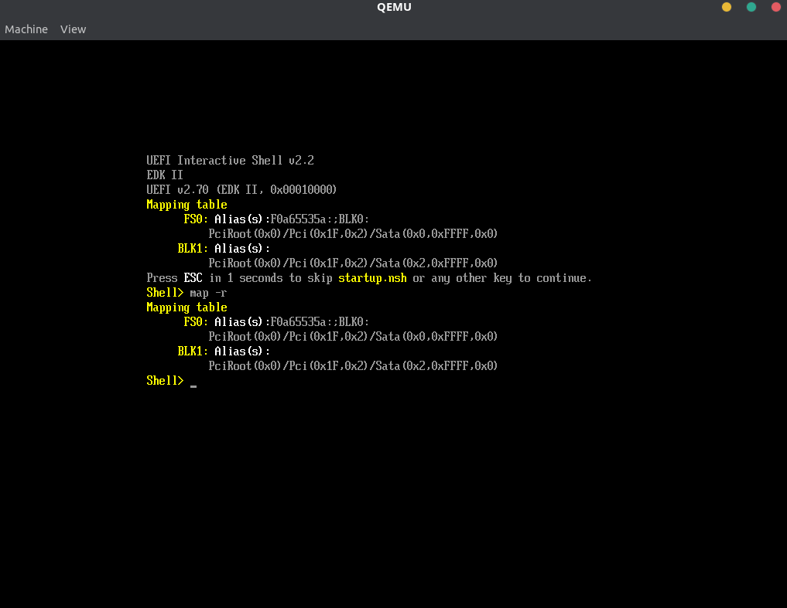
</p>

*Figura 1. Arranque de la UEFI Shell en QEMU.*

### Exploración de dispositivos y protocolos

En la UEFI Shell se ejecutaron:

```text
map
map -r
fs0:
ls
dh -b
```

`map` permite visualizar los alias de sistemas de archivos y dispositivos de bloque; `dh` enumera *handles* y protocolos asociados. Para disponer de `FS0:` se utilizó un volumen accesible desde UEFI.

<p align="center">
  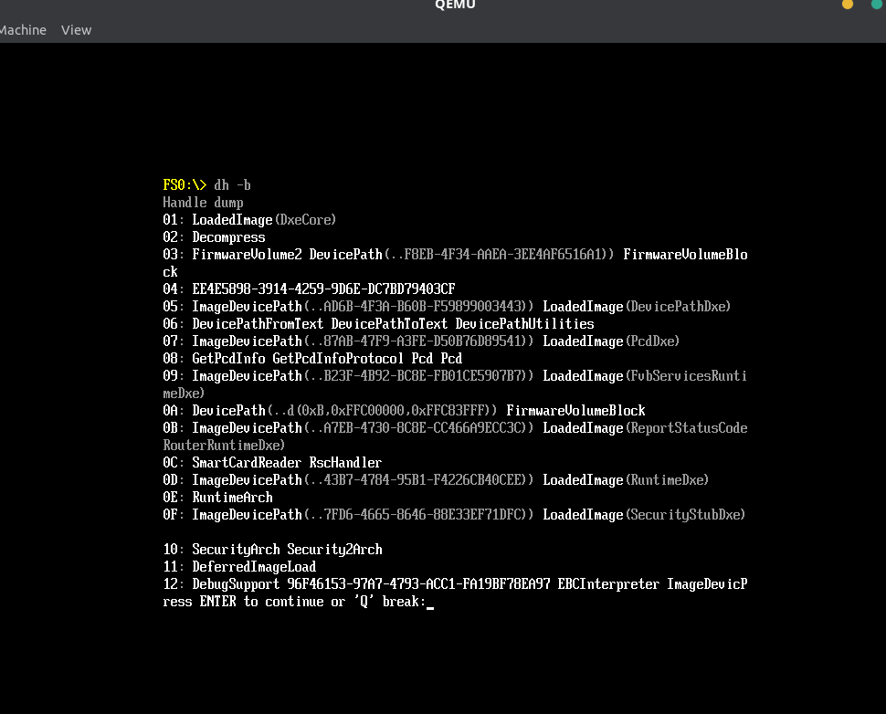
</p>

*Figura 2. Enumeración de handles y protocolos.*

**Pregunta 1 — ¿Qué ventajas tiene el modelo de handles y protocolos frente al BIOS tradicional?**

El modelo desacopla las aplicaciones de direcciones o puertos de hardware fijos y facilita la interoperabilidad entre distintos controladores y dispositivos. Además, ofrece interfaces estandarizadas que permiten delimitar qué servicios utiliza una aplicación. **No constituye por sí solo una barrera de seguridad:** la confianza en los controladores y el firmware sigue siendo fundamental.

### Variables de arranque y NVRAM

```text
dmpstore
dmpstore BootOrder
set TestSeguridad "Hola UEFI"
set TestSeguridad
```

Se inspeccionaron variables como `Boot0000`, `Boot0001`, `Boot0002`, `BootOrder` y `BootCurrent`.

<p align="center">
  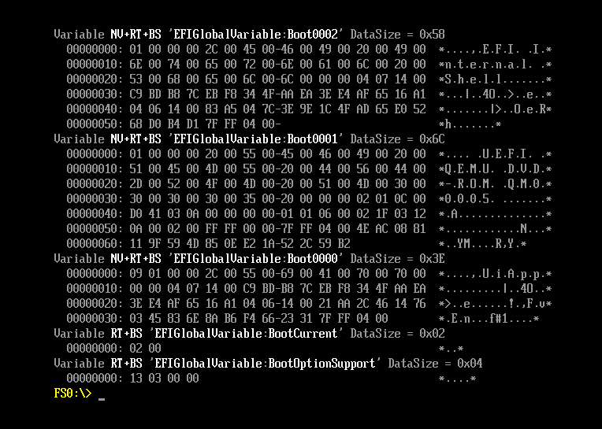
</p>

*Figura 3. Inspección de las variables de arranque.*

<p align="center">
  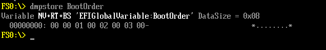
</p>

*Figura 4. Orden de las opciones de arranque.*

**Pregunta 2 — ¿Cómo determina el Boot Manager la secuencia de arranque?**

`BootOrder` contiene una lista ordenada de identificadores que remiten a variables `Boot####`. Cada entrada describe una opción de arranque, incluido el dispositivo y la ruta del cargador. El firmware intenta las opciones según el orden configurado, sujeto a políticas y condiciones del equipo. `BootCurrent` identifica la opción utilizada en el arranque actual.

> El comando `set` de la Shell gestiona variables de su entorno; no debe confundirse automáticamente con crear una variable global UEFI persistente mediante Runtime Services.

<p align="center">
  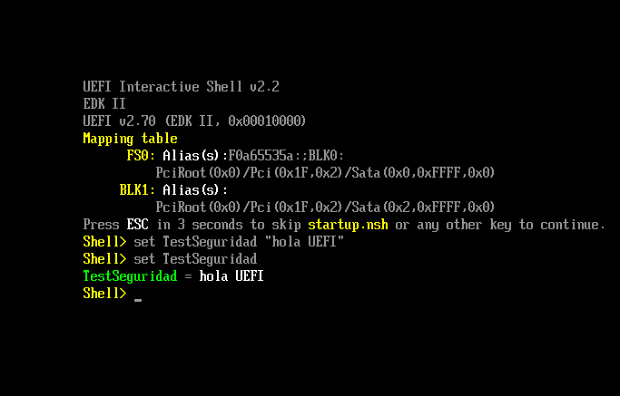
</p>

*Figura 5. Variable de prueba en el entorno de la Shell.*

### Memoria, PCI y controladores

```text
memmap -b
pci -b
drivers -b
```

En QEMU se observaron regiones `BS_Code`, `BS_Data`, `RT_Code`, `RT_Data`, memoria disponible, ACPI y MMIO, junto con dispositivos PCI y controladores UEFI.

<p align="center">
  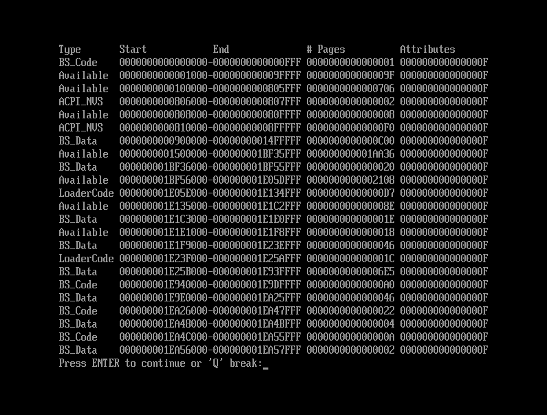
</p>

*Figura 6. Mapa de memoria UEFI.*

<p align="center">
  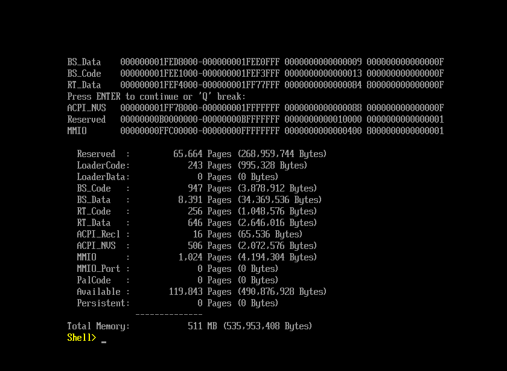
</p>

*Figura 7. Detalle y resumen de las regiones de memoria.*

<p align="center">
  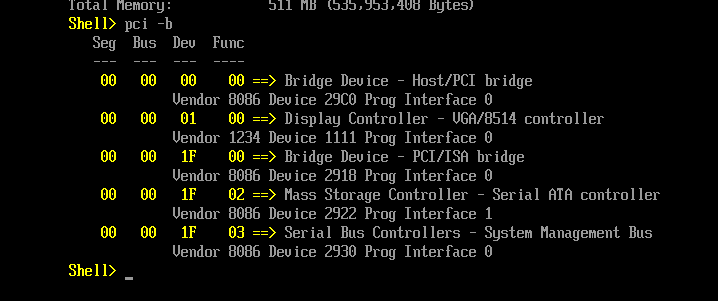
</p>

*Figura 8. Enumeración de dispositivos PCI.*

<p align="center">
  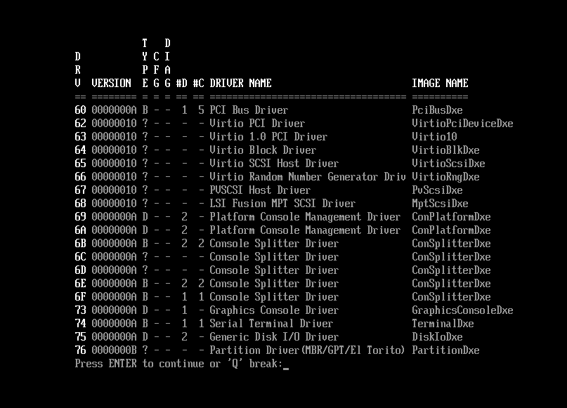
</p>

*Figura 9. Controladores disponibles en el entorno virtual.*

**Pregunta 3 — ¿Por qué son sensibles las regiones RuntimeServicesCode?**

Contienen código destinado a seguir disponible para determinados servicios del firmware después de `ExitBootServices()`. Si un atacante consiguiera alterar ese código o sus mecanismos de acceso, podría afectar operaciones privilegiadas del sistema y dificultar la detección de una intrusión. La persistencia y la explotabilidad dependen de la plataforma y de sus protecciones.

## TP2 — Desarrollo, compilación y análisis

**Objetivo:** generar un ejecutable nativo UEFI en formato PE/COFF y relacionar el código fuente con su representación ensamblador.

### Aplicación en C

El código de la aplicación utilizada fue el siguiente:

```c
#include <efi.h>
#include <efilib.h>

EFI_STATUS EFIAPI efi_main(EFI_HANDLE ImageHandle, EFI_SYSTEM_TABLE *SystemTable) {
    volatile unsigned char code[] = {0xCC};

    uefi_call_wrapper(SystemTable->ConOut->ClearScreen, 1, SystemTable->ConOut);
    uefi_call_wrapper(SystemTable->ConOut->OutputString, 2,
                      SystemTable->ConOut, L"Iniciando analisis de seguridad...\r\n");

    if (code[0] == 0xCC) {
        uefi_call_wrapper(SystemTable->ConOut->OutputString, 2,
                          SystemTable->ConOut, L"Breakpoint estatico alcanzado.\r\n");
    }

    uefi_call_wrapper(SystemTable->BootServices->Stall, 1, 5000000);
    return EFI_SUCCESS;
}
```

**Pregunta 4 — ¿Por qué se utiliza `SystemTable->ConOut->OutputString` y no `printf`?**

Una aplicación UEFI se ejecuta sin depender de la biblioteca estándar ni de la consola de un sistema operativo. `ConOut->OutputString` es el servicio de salida de texto provisto por UEFI. GNU-EFI también ofrece funciones auxiliares como `Print`, pero el uso directo del protocolo permite observar la interfaz del firmware.

### Compilación

La aplicación se compiló con GCC y GNU-EFI, se enlazó con `ld` y se convirtió a formato EFI con `objcopy`:

```bash
gcc -I/usr/include/efi -I/usr/include/efi/x86_64 \
  -I/usr/include/efi/protocol -fpic -ffreestanding \
  -fno-stack-protector -fno-strict-aliasing -fshort-wchar \
  -mno-red-zone -maccumulate-outgoing-args -Wall \
  -c -o aplicacion.o aplicacion.c

ld -shared -Bsymbolic -L/usr/lib \
  -T /usr/lib/elf_x86_64_efi.lds \
  /usr/lib/crt0-efi-x86_64.o aplicacion.o \
  -o aplicacion.so -lefi -lgnuefi

objcopy -j .text -j .sdata -j .data -j .rodata \
  -j .dynamic -j .dynsym -j .rel -j .rela \
  -j '.rel.*' -j '.rela.*' -j .reloc \
  --target=efi-app-x86_64 aplicacion.so aplicacion.efi
```

Verificación:

```bash
file aplicacion.efi
objdump -x aplicacion.efi
```

El resultado de `file` confirmó **`PE32+ executable (EFI application) x86-64`**; el ejecutable generado tenía un tamaño aproximado de **5,1 KB**. `readelf -h` no es apropiado para inspeccionar el encabezado del PE/COFF final, porque `readelf` está diseñado para ELF.

<p align="center">
  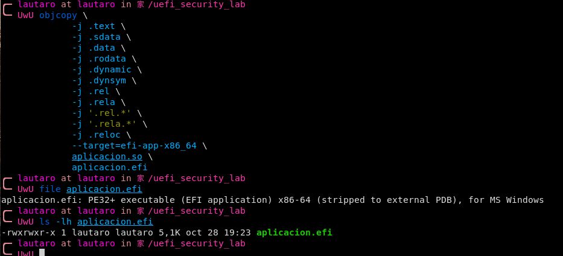
</p>

*Figura 10. Generación y verificación del ejecutable EFI.*

### Ingeniería inversa con Ghidra

Se importó `aplicacion.efi`, se ejecutó el análisis automático y se localizaron las funciones `entry`, `efi_main`, `efi_call1`, `efi_call2` y `_relocate`. La advertencia de ausencia de un archivo PDB no impidió el análisis.

<p align="center">
  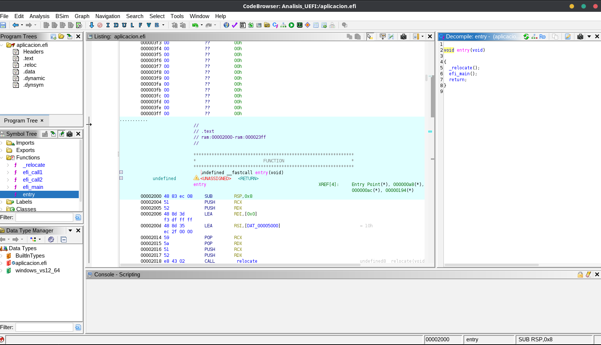
</p>

*Figura 11. Análisis del ejecutable en Ghidra.*

En el panel **Listing** de `efi_main` se identificaron las instrucciones relevantes:

```asm
MOV    byte ptr [RBP + local_9], 0xCC
MOVZX  EAX, byte ptr [RBP + local_9]
CMP    AL, 0xCC
JNZ    LAB_000020bd
```

Estas instrucciones almacenan el byte, lo leen con extensión sin signo, lo comparan y saltan si es diferente. El panel **Decompiler** mostró una versión simplificada de `efi_main` con llamadas auxiliares, por lo que fue necesario revisar el ensamblador para confirmar la comparación.

<p align="center">
  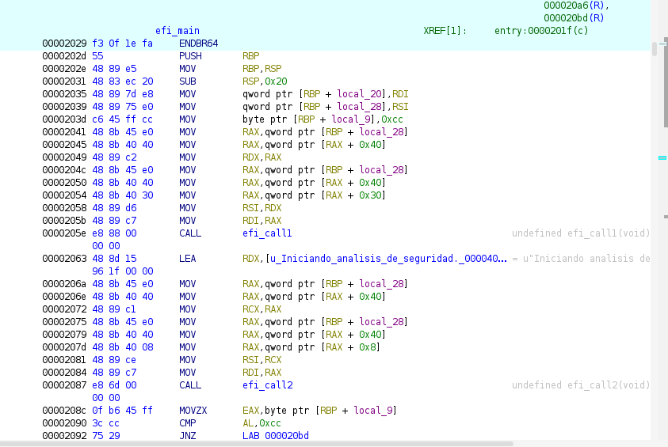
</p>

*Figura 12. Instrucciones de efi_main y comparación con 0xCC.*

**Pregunta 5 — ¿Por qué `0xCC` puede aparecer como `-52`?**

El patrón binario `11001100` representa **204** si se interpreta como `unsigned char` y **−52** si se interpreta como `signed char` de 8 bits en complemento a dos. La interpretación de tipos y signos es importante en ingeniería inversa porque afecta la lectura de comparaciones y posibles fallas de seguridad. En este caso se observó `CMP AL,0xCC` en el ensamblador; **no se observó necesariamente `-52` en el pseudocódigo**. Aunque `0xCC` es también el opcode x86 de `INT3`, aquí se utilizó **como dato**, no como una instrucción de breakpoint ejecutada.

### Prueba en QEMU

Se expuso la carpeta de trabajo como un volumen FAT virtual en QEMU. Desde la UEFI Shell se actualizaron los dispositivos con `map -r`, se accedió a `FS0:` y se ejecutó `aplicacion.efi`.

La aplicación mostró los mensajes previstos, esperó aproximadamente cinco segundos y devolvió el control a la Shell.

<p align="center">
  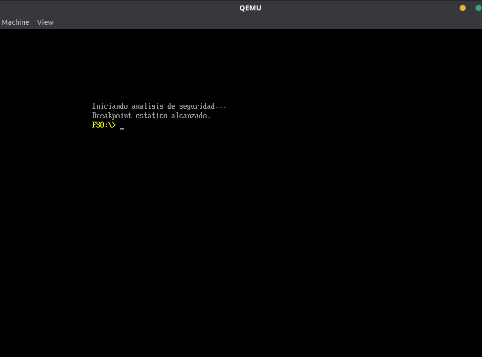
</p>

*Figura 13. Ejecución de la aplicación en QEMU.*

## TP3 — Ejecución en hardware físico

**Objetivo:** ejecutar el mismo binario UEFI en una computadora real, fuera de QEMU y sin iniciar un sistema operativo.

### Preparación del USB

Se identificó el pendrive con `lsblk` y se preparó una partición FAT32. La estructura utilizada fue:

```text
USB (FAT32)/
├── EFI/
│   └── BOOT/
│       └── BOOTX64.EFI    # UEFI Shell x86-64 de TianoCore
└── aplicacion.efi         # Aplicación del TP2
```

Se verificaron ambos archivos con `file`: los dos fueron reconocidos como aplicaciones EFI x86-64.

### Configuración del firmware Lenovo

En la **Lenovo IdeaPad 5** se comprobó que:

- **Secure Boot:** `Disabled`.
- **USB Boot:** `Enabled`.
- **Modo de arranque:** UEFI (el dispositivo apareció como `EFI USB Device`).

Desde el menú de arranque se seleccionó **EFI USB Device (Generic Flash Disk)**. Se inició la **UEFI Interactive Shell v2.1** sobre firmware UEFI de **Insyde**.

### Ejecución bare metal

En el equipo físico, `map -r` mostró:

- **`FS0:`**: volumen del pendrive USB.
- **`FS1:`**: partición EFI del SSD NVMe interno.

Luego se ejecutó:

```text
Shell> fs0:
FS0:\> ls
FS0:\> aplicacion.efi
```

**Salida observada:**

```text
Iniciando analisis de seguridad...
Breakpoint estatico alcanzado.
FS0:\>
```

El retorno al prompt confirma que la aplicación terminó y devolvió el control a la Shell.

## Resultados

| Trabajo práctico | Evidencia principal | Estado |
| --- | --- | --- |
| TP1 | Enumeración de handles, variables de arranque, memoria, PCI y drivers en QEMU | Completado |
| TP2 | Compilación PE/COFF, análisis de `0xCC` en Ghidra y ejecución en QEMU | Completado |
| TP3 | Arranque UEFI por USB y ejecución de `aplicacion.efi` en Lenovo IdeaPad 5 | Completado |

**Conclusión:** se verificó el flujo completo desde el desarrollo y la inspección de una aplicación UEFI hasta su ejecución en un firmware real. El experimento permite comprender la interfaz de servicios UEFI, el formato PE/COFF y las diferencias entre un entorno emulado y uno físico. No se explotó ninguna vulnerabilidad ni se ejecutó un breakpoint real.

## Consideraciones de seguridad

La práctica utilizó una aplicación propia y requirió deshabilitar Secure Boot para ejecutar el binario sin firma en el equipo físico. Esta configuración reduce la verificación de autenticidad del código de arranque. El análisis también permitió distinguir las variables del entorno de la Shell de las variables UEFI y reconocer la sensibilidad de las regiones de memoria que contienen servicios de runtime.

## Referencias

- [TianoCore EDK II](https://github.com/tianocore/edk2)
- [GNU-EFI](https://sourceforge.net/projects/gnu-efi/)
- [QEMU](https://www.qemu.org/)
- [Ghidra](https://ghidra-sre.org/)
- [UEFI Forum — Specifications](https://uefi.org/specifications)
